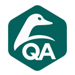
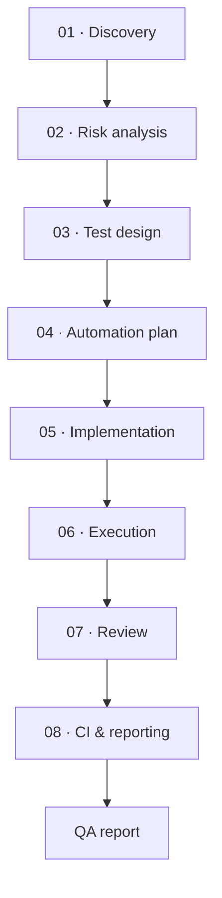

<div align="center">



# GooseQA Toolkit

**From an unfamiliar codebase to a reliable test suite.**

An AI-assisted QA workflow that discovers risks, designs tests, implements automation,
runs real checks, and reviews results — with a local dashboard to track every stage.


**English** | [Русский](README.ru.md)

[Install](#installation) · [Quick start](#quick-start) · [Workflow](#workflow) · [Dashboard](#dashboard) · [Model routing](#model-routing) · [Commands](#commands)

</div>

---

## Why GooseQA?

- **Continuous QA workflow** — run eight stages in AUTO mode without a separate prompt for each stage.
- **Evidence-first testing** — record actual test results, commands, defects, and supporting evidence.
- **Adaptive model routing** — plan subagent assignments using the host's available capabilities and user preferences.
- **Three working modes** — learn automation, collaborate with an agent, or delegate an approved QA scope.
- **Local-first dashboard** — monitor progress, edit QA records, and configure model preferences without a hosted backend or additional AI API keys.
- **Resumable progress** — continue from the last recorded stage instead of restarting the audit.

Supports QA planning for web UI, API, unit, integration, visual, desktop, game, and AI systems. The agent selects an appropriate test stack for the project.

## Installation

Requires Python 3.10+, Git, and Node.js (with npm/npx) for the skills CLI. Install and sign in to your preferred coding agent first.

### Codex

Install globally:

```sh
npx skills add goosevv/gooseqa-toolkit --skill gooseqa -g -y -a codex
```

### Claude Code

1. With [Claude Code](https://code.claude.com/docs/en/quickstart) installed, open a terminal and install the skill globally:

   ```sh
   npx skills add goosevv/gooseqa-toolkit --skill gooseqa -g -y -a claude-code
   ```

2. Open your target project in Claude Code (replace `/path/to/project` with its path):

   ```sh
   cd /path/to/project
   claude
   ```

3. In the Claude Code session, run:

   ```text
   /gooseqa start AUTO
   ```

   Use `LEARN` or `PAIR` instead for guided or collaborative work.

Omit `-g` and run the installer from your target project for a project-only installation. The global skill is available under `~/.claude/skills/gooseqa/`. If the command is not recognized, check the installation and reopen Claude Code.

Claude Code integration is experimental; native subagent capabilities and dashboard preview support depend on the client. See the [skills CLI](https://github.com/vercel-labs/skills) and [Claude Code skill documentation](https://code.claude.com/docs/en/skills).

<details>
<summary>Alternative installation methods</summary>

### Local installer

```sh
git clone https://github.com/goosevv/gooseqa-toolkit.git
cd gooseqa-toolkit
python qa.py install-skill codex --global
```

Use `py -3` on Windows or `python3` when necessary. Replace `--global` with `--project /path/to/project` for a project-level installation.

### Codex plugin (experimental)

```sh
codex plugin marketplace add goosevv/gooseqa-toolkit
```

Select GooseQA Toolkit from the added marketplace. Native marketplace installation still requires verification.

### Claude Code — local installer

From the cloned repository (use this instead of the skills CLI):

```sh
python qa.py install-skill claude --global
```

Open the target project in Claude Code and invoke `/gooseqa start`.

Choose one installation method per agent to avoid duplicate skills.

</details>

## Quick start

Open the project you want to test and invoke the skill in your agent.

**Codex:**

```text
$gooseqa start AUTO
```

**Claude Code:**

```text
/gooseqa start AUTO
```

GooseQA creates or resumes the local QA workspace, opens the dashboard when supported, and starts the workflow within the approved testing scope.

| Mode | Best for | Behavior |
| --- | --- | --- |
| **LEARN** | Learning automation | Exercises, hints, and feedback. Pauses for your attempts. |
| **PAIR** | Collaborative QA | Works with you and pauses for required decisions. |
| **AUTO** | Delegating QA | Continues across stages until completion or a real blocker. |

```text
$gooseqa start LEARN
$gooseqa start PAIR
$gooseqa start AUTO
```

Without a mode, a new workspace defaults to LEARN; an existing workspace retains its saved mode.

## Workflow



Each stage requires genuine completion and satisfied evidence gates. In AUTO, the agent advances automatically, attempts bounded safe corrections when blocked, and saves progress before stopping. A subsequent invocation resumes the saved stage.

The workflow runs in the active agent session; it is not a detached background AI process. Quality gates validate recorded evidence, not the correctness of the test assertions.

### Persistent QA workflow

- **Smart Resume** — persistent stage checkpoints and blocker details; inspect actual changes before retrying.
- **Project Memory** — local, sourced architecture, commands, conventions and lessons across cycles.
- **Incremental Testing** — Git-based candidate selection using a reviewed clean baseline and verified file-to-case mappings; unknown changes fall back to full testing, P0 always included.
- **QA Reviewer** — evidence-bound review gate, distinct native reviewer when available, explicitly labeled self-review otherwise.

Use `$gooseqa cycle` (Claude: `/gooseqa cycle`) after a completed cycle. The agent verifies impact and executes the chosen tests; the CLI does not run tests or dispatch agents itself. [Persistent QA guide](skills/gooseqa/references/persistent-qa.md).

## Dashboard

A compact, responsive QA workspace designed for narrow in-app browser panes as well as desktop browsers.

| Section | What it tracks |
| --- | --- |
| Overview | Progress, coverage, recent results, open defects |
| Workflow | Stage notes and quality gates |
| Risks | Risk priorities and rationale |
| Test cases | Test design, coverage, automation references |
| Runs | Recorded results and execution evidence |
| Defects | Open and closed bugs |
| Learning | Exercises and completion |
| AI Configuration | Global model routing preferences |

Includes **English / Russian** language switching, light/dark themes, local Iconify (Lucide) icons, and Markdown report export.

```text
$gooseqa dashboard
```

The dashboard prefers the agent's in-app browser or preview when supported; otherwise the local URL can be opened manually. It displays and edits state, rather than independently launching AI work.

## Model routing

GooseQA separates QA roles from provider-specific model names.

| Profile | Concurrent subagents (maximum) |
| --- | ---: |
| ECO | 0 |
| BALANCED (default) | 2 |
| QUALITY | 4 |
| CUSTOM | User-defined, up to 8 |

Actual delegation is limited by the host. The router plans assignments using FAST, BALANCED, REASONING, and VISION capabilities. Test execution uses deterministic CLI tools.

Configure automatic or manual model selection, compatible fallback, and reasoning effort in **AI Configuration**. The original strict Codex preset remains available. Global settings are shared across projects.

Codex, Claude Code, Gemini CLI, and generic/local agents share an inventory contract. Automatic provider-specific model discovery and native dispatch are not implemented: the host agent must supply observed capabilities and execute supported actions. If native delegation is unavailable, the router can plan work for the existing session, subject to the configured constraints.

[Read the model routing guide](docs/model-routing.md)

## Commands

| Skill command | Purpose |
| --- | --- |
| `$gooseqa start [MODE]` | Start or resume QA and open the dashboard |
| `$gooseqa next` | Resume work; continue in AUTO |
| `$gooseqa dashboard` | Open the local dashboard |
| `$gooseqa status` | Inspect progress and blockers |
| `$gooseqa plan` | Design a risk-based test plan |
| `$gooseqa run` | Execute relevant tests |
| `$gooseqa review` | Review test quality and evidence |
| `$gooseqa report` | Export a Markdown report |
| `$gooseqa mode LEARN` | Change the working mode |

These are skill arguments, not separate built-in Codex commands. Claude Code uses the `/gooseqa` invocation where installed.

<details>
<summary>Local CLI and development</summary>

Run the installed script from your target project directory (example for a global Codex installation):

```sh
python ~/.agents/skills/gooseqa/scripts/qa.py start AUTO
```

Use `--no-browser` when opening the returned URL through the host's preview tools.

From the toolkit repository:

```sh
python qa.py model-config
python qa.py model-config-set settings.json
python qa.py model-plan host.json
python -m unittest discover -s tests -v
node --check static/app.js
```

Project records: `.gooseqa/state.json`. Global model preferences: `~/.gooseqa/model-settings.json` (override with `GOOSEQA_CONFIG`). Keep secrets out of both files, and keep project QA data out of version control.

The dashboard binds to loopback only; it is not intended for public hosting.

</details>

## Documentation

[Skill instructions](skills/gooseqa/SKILL.md) · [Model routing](docs/model-routing.md) · [Dashboard design](docs/dashboard-design.md) · [Automation guidelines](skills/gooseqa/references/automation.md) · [State contract](skills/gooseqa/references/state-contract.md) · [Verification & limitations](VERIFICATION.md)

> **Early development:** native client integrations, Windows behavior, browser E2E, and the full Python test suite for the latest model router still require verification. Model plans are not proof of actual model execution. No token savings are claimed.

---

<div align="center">

**Learn by testing. Automate with confidence.**

[Report a bug](https://github.com/goosevv/gooseqa-toolkit/issues) · [Suggest an improvement](https://github.com/goosevv/gooseqa-toolkit/issues)

</div>
