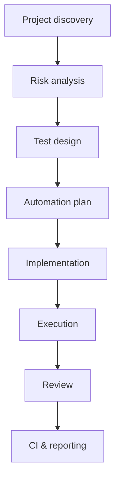

<div align="center">

# 🪿 GooseQA Toolkit

**From an unfamiliar codebase to a reliable test suite.**

An AI-assisted QA workflow and local dashboard for learning, writing, running, and reviewing automated tests.


[Install](#installation) · [Quick start](#quick-start) · [Workflow](#workflow) · [Commands](#commands) · [Documentation](#documentation)

</div>

---

## Installation

**Requirements:** Python 3.10+, Git, and Node.js for the skills CLI.

Install globally as a Codex skill:

```sh
npx skills add goosevv/gooseqa-toolkit --skill gooseqa -g -y -a codex
```

<details>
<summary>Alternative installation methods</summary>

**Local installer**

```sh
git clone https://github.com/goosevv/gooseqa-toolkit.git
cd gooseqa-toolkit
python qa.py install-skill codex --global
```

Use `py -3` on Windows or `python3` on Linux/macOS if needed. Replace `--global` with `--project /path/to/project` for project-level installation.

**Codex plugin (experimental)**

```sh
codex plugin marketplace add goosevv/gooseqa-toolkit
```

Install GooseQA Toolkit from the added marketplace in Codex. Native marketplace installation has not yet been verified.

**Claude Code (experimental)**

```sh
python qa.py install-skill claude --global
```

Run `/gooseqa start` inside Claude Code. Universal model routing is available; native delegation depends on the current host.

Choose one installation method per agent to avoid duplicate skills.

</details>

## Quick start

Open a target project in Codex and invoke:

```text
$gooseqa start
```

GooseQA creates or resumes the QA workspace, starts a local dashboard, prefers the agent’s in-app browser when supported, and guides the agent through the next QA stage.

| Mode | Purpose |
| --- | --- |
| **LEARN** | Guided exercises, hints, and feedback. |
| **PAIR** | Collaborate on test design and implementation. |
| **AUTO** | Delegate an approved testing scope to the agent. |

```text
$gooseqa start LEARN
$gooseqa start PAIR
$gooseqa start AUTO
```

New workspaces default to LEARN. Existing workspaces retain their progress and mode. In AUTO, start and next proceed through all eight stages without routine confirmations, stopping at completion or a real blocker. This is a host-driven loop, not a detached background agent.

## Workflow



Choose the right testing level for the project: UI, API, unit, integration, visual, desktop, game, or AI evaluation. Playwright and TypeScript are the recommended starting point for web automation.

## Features

| Capability | Description |
| --- | --- |
| Project analysis | Discover architecture, requirements, risks, and existing coverage. |
| QA dashboard | Track stages, risks, test cases, execution evidence, defects, and learning tasks. |
| Quality gates | Check required records and evidence before advancing stages. |
| Learning mode | Practice automation through real project tasks. |
| Persistent workspace | Resume across agent sessions without losing progress. |
| Local-first runtime | Python standard library, no additional AI API keys or hosted backend. |
| Reporting | Export a Markdown QA report. |

The dashboard has a compact responsive layout, collapsible navigation in narrow panes, locally embedded Iconify (Lucide) icons, light/dark themes, and English/Russian language selection. It polls the local state every three seconds while visible and avoids refreshing focused form controls.

## Commands

| Command | Action |
| --- | --- |
| `$gooseqa start [MODE]` | Start or resume a workspace and open the dashboard. |
| `$gooseqa dashboard` | Open the dashboard. |
| `$gooseqa status` | Inspect progress and blockers. |
| `$gooseqa plan` | Design a risk-based test plan. |
| `$gooseqa next` | Continue the workflow. |
| `$gooseqa run` | Execute relevant tests through the agent. |
| `$gooseqa review` | Review test quality and execution evidence. |
| `$gooseqa report` | Export a QA report. |
| `$gooseqa mode LEARN` | Change the working mode. |

These are skill arguments, not separate built-in Codex commands.

## Model policy

GooseQA uses a [capability-based model router](docs/model-routing.md) across hosts. Configure global preferences in AI Configuration, with ECO/BALANCED/QUALITY/CUSTOM profiles, automatic or manual mapping and the original strict Codex preset. Native delegation and model switching depend on the host; plans are not execution evidence.

## Local data & development

Project state lives in `.gooseqa/state.json`. Keep this directory out of version control and never store credentials or sensitive test data in it. The dashboard binds to loopback only and is not intended for public hosting.

<details>
<summary>Run the dashboard manually or test the toolkit</summary>

From a target project's root, run the installed skill script (example for a global Codex installation):

```sh
python ~/.agents/skills/gooseqa/scripts/qa.py start LEARN
```

In an agent with an in-app browser, the skill starts with `--no-browser` and opens the returned HTTP URL using the host preview/browser tools when available. Otherwise use the returned dashboard URL or the default external-browser request. Local loopback accessibility depends on the client and execution environment; no public tunnel is required or enabled.

From the toolkit repository:

```sh
python -m unittest discover -s tests -v
node --check static/app.js
```

</details>

## Documentation

- [Skill instructions](skills/gooseqa/SKILL.md)
- [Automation guidelines](skills/gooseqa/references/automation.md)
- [State contract](skills/gooseqa/references/state-contract.md)
- [Model routing](docs/model-routing.md)
- [Verification and limitations](VERIFICATION.md)

> **Early development:** GooseQA stores and displays test evidence; the agent runs the actual tests. Quality gates validate records, not the correctness of test assertions. Native client installation, Windows behavior, and browser E2E still require verification.

---

<div align="center">

**Learn by testing. Automate with confidence.**

[Report a bug](https://github.com/goosevv/gooseqa-toolkit/issues) · [Suggest an improvement](https://github.com/goosevv/gooseqa-toolkit/issues)

</div>
