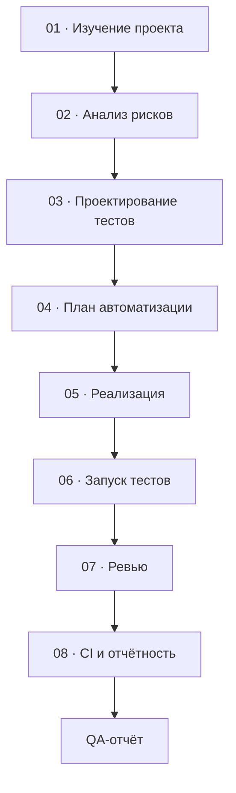

<div align="center">

# 🪿 GooseQA Toolkit

**От незнакомой кодовой базы к надёжному набору тестов.**

QA-процесс с поддержкой ИИ: анализ рисков, проектирование тестов, автоматизация,
реальные запуски и проверка результатов — с локальным дашбордом для каждого этапа.


[English](README.md) | **Русский**

[Установка](#установка) · [Быстрый старт](#быстрый-старт) · [Workflow](#workflow) · [Дашборд](#дашборд) · [Маршрутизация моделей](#маршрутизация-моделей) · [Команды](#команды)

</div>

---

## Зачем GooseQA?

- **Непрерывный QA-процесс** — прохождение восьми этапов в режиме AUTO без отдельной команды для каждого.
- **Тестирование на основе доказательств** — запись фактических результатов, команд запуска, дефектов и подтверждающих материалов.
- **Адаптивная маршрутизация моделей** — планирование назначения субагентов с учётом возможностей клиента и настроек пользователя.
- **Три режима работы** — обучение автоматизации, совместная работа или делегирование согласованного объёма тестирования.
- **Локальный дашборд** — прогресс, QA-записи и настройки моделей без облачного бэкенда и дополнительных ключей AI API.
- **Возобновляемый прогресс** — продолжение с последнего сохранённого этапа.

Поддерживается планирование UI-, API-, модульных, интеграционных, визуальных тестов, а также тестирования desktop-приложений, игр и AI-систем. Агент подбирает подходящие инструменты под проект.

## Установка

Требуются Python 3.10+, Git и Node.js (с npm/npx для skills CLI). Предварительно установите выбранный AI-клиент и войдите в аккаунт.

### Codex

Глобальная установка:

```sh
npx skills add goosevv/gooseqa-toolkit --skill gooseqa -g -y -a codex
```

### Claude Code

1. Установите [Claude Code](https://code.claude.com/docs/en/quickstart), если он ещё не установлен. Откройте терминал и установите скилл глобально:

   ```sh
   npx skills add goosevv/gooseqa-toolkit --skill gooseqa -g -y -a claude-code
   ```

2. Откройте тестируемый проект в Claude Code (замените `/path/to/project` на путь к проекту):

   ```sh
   cd /path/to/project
   claude
   ```

3. В сессии Claude Code выполните команду:

   ```text
   /gooseqa start AUTO
   ```

   Для обучения или совместной работы вместо AUTO выберите LEARN или PAIR.

Для установки только в один проект уберите флаг `-g` и выполните команду установки из корня целевого проекта. При глобальной установке скилл доступен в `~/.claude/skills/gooseqa/`. Если команда не появилась, проверьте установку и перезапустите Claude Code.

Интеграция с Claude Code экспериментальная: возможности субагентов и встроенного просмотра дашборда зависят от клиента. Подробнее: [skills CLI](https://github.com/vercel-labs/skills) и [документация скиллов Claude Code](https://code.claude.com/docs/en/skills).

<details>
<summary>Альтернативные способы установки</summary>

### Локальный установщик

```sh
git clone https://github.com/goosevv/gooseqa-toolkit.git
cd gooseqa-toolkit
python qa.py install-skill codex --global
```

На Windows при необходимости используйте `py -3`, на Linux/macOS — `python3`. Для установки в конкретный проект замените `--global` на `--project /path/to/project`.

### Плагин Codex (экспериментально)

```sh
codex plugin marketplace add goosevv/gooseqa-toolkit
```

Выберите GooseQA Toolkit в добавленном marketplace. Нативная установка из marketplace ещё требует проверки.

### Claude Code — локальный установщик

Из клонированного репозитория (вместо skills CLI):

```sh
python qa.py install-skill claude --global
```

Откройте целевой проект в Claude Code и выполните `/gooseqa start`.

Выбирайте один способ установки для каждого AI-клиента, чтобы не создавать дубликаты скилла.

</details>

## Быстрый старт

Откройте проект, который хотите протестировать, и вызовите скилл.

**Codex:**

```text
$gooseqa start AUTO
```

**Claude Code:**

```text
/gooseqa start AUTO
```

GooseQA создаёт или возобновляет локальное QA-пространство, открывает дашборд при наличии поддержки и начинает работу в согласованных границах тестирования.

| Режим | Назначение | Поведение |
| --- | --- | --- |
| **LEARN** | Обучение автоматизации | Упражнения, подсказки и обратная связь. Паузы для самостоятельных попыток. |
| **PAIR** | Совместное тестирование | Совместная работа с паузами для необходимых решений. |
| **AUTO** | Делегирование QA | Продолжение работы до завершения или реальной блокировки. |

```text
$gooseqa start LEARN
$gooseqa start PAIR
$gooseqa start AUTO
```

Без указания режима новое пространство создаётся в LEARN, а существующее сохраняет текущий режим.

## Workflow



Каждый этап требует фактического завершения работы и прохождения проверок наличия доказательств (quality gates). В AUTO агент автоматически переходит дальше, предпринимает ограниченные безопасные попытки устранить блокировки и сохраняет прогресс перед остановкой. Следующий запуск продолжает сохранённый этап.

Процесс выполняется в активной сессии агента, а не в отдельном фоновом AI-процессе. Quality gates проверяют наличие записанных доказательств, а не корректность тестовых утверждений.

## Дашборд

Компактное адаптивное QA-пространство для узких встроенных панелей браузера и обычных desktop-браузеров.

| Раздел | Содержание |
| --- | --- |
| Обзор | Прогресс, покрытие, последние результаты, открытые дефекты |
| Процесс QA | Заметки по этапам и quality gates |
| Риски | Приоритеты рисков и обоснования |
| Тест-кейсы | Тест-дизайн, покрытие, ссылки на автотесты |
| Запуски | Результаты и доказательства выполнения |
| Дефекты | Открытые и закрытые баги |
| Обучение | Упражнения и их выполнение |
| Настройки ИИ | Глобальные параметры маршрутизации моделей |

Поддерживаются **английский и русский языки**, светлая и тёмная темы, локальные иконки Iconify (Lucide) и экспорт Markdown-отчёта.

```text
$gooseqa dashboard
```

В Claude Code: `/gooseqa dashboard`.

Дашборд открывается во встроенном браузере или предпросмотре агента, если клиент это поддерживает. Иначе можно вручную открыть локальный URL. Дашборд отображает и редактирует состояние, но не запускает AI-задачи самостоятельно.

## Маршрутизация моделей

GooseQA отделяет QA-роли от названий моделей конкретных поставщиков.

| Профиль | Максимум параллельных субагентов |
| --- | ---: |
| ECO | 0 |
| BALANCED (по умолчанию) | 2 |
| QUALITY | 4 |
| CUSTOM | Настраивается, до 8 |

Фактическое делегирование ограничено возможностями клиента. Маршрутизатор планирует распределение задач по классам FAST, BALANCED, REASONING и VISION. Для запуска тестов используются обычные CLI-инструменты.

В разделе **Настройки ИИ** можно выбрать автоматическое или ручное распределение, разрешить совместимые замены и ограничить reasoning effort. Исходный строгий пресет Codex сохранён. Глобальные настройки действуют для всех проектов.

Codex, Claude Code, Gemini CLI и универсальные/локальные агенты используют общий формат описания возможностей. Автоматическое обнаружение моделей для конкретных поставщиков и нативный запуск субагентов не реализованы: сам AI-клиент предоставляет сведения о доступных возможностях и выполняет поддерживаемые действия. При отсутствии нативного делегирования маршрутизатор может планировать работу в текущей сессии с учётом настроенных ограничений.

[Подробнее о маршрутизации моделей (EN)](docs/model-routing.md)

## Команды

| Команда скилла | Назначение |
| --- | --- |
| `$gooseqa start [MODE]` | Начать или возобновить QA и открыть дашборд |
| `$gooseqa next` | Продолжить работу; в AUTO — продолжить весь процесс |
| `$gooseqa dashboard` | Открыть локальный дашборд |
| `$gooseqa status` | Проверить прогресс и блокировки |
| `$gooseqa plan` | Составить тест-план на основе рисков |
| `$gooseqa run` | Запустить подходящие тесты |
| `$gooseqa review` | Проверить качество тестов и доказательства |
| `$gooseqa report` | Экспортировать Markdown-отчёт |
| `$gooseqa mode LEARN` | Изменить режим работы |

Это аргументы скилла, а не отдельные встроенные команды Codex. В Claude Code используйте `/gooseqa` вместо `$gooseqa`.

<details>
<summary>Локальный CLI и разработка</summary>

Запускайте установленный скрипт из корня целевого проекта (пример глобальной установки Codex):

```sh
python ~/.agents/skills/gooseqa/scripts/qa.py start AUTO
```

Для Claude Code путь к глобально установленному скрипту — `~/.claude/skills/gooseqa/scripts/qa.py`.

Флаг `--no-browser` позволяет открыть полученный URL через инструменты предпросмотра AI-клиента.

Из репозитория тулкита:

```sh
python qa.py model-config
python qa.py model-config-set settings.json
python qa.py model-plan host.json
python -m unittest discover -s tests -v
node --check static/app.js
```

Данные проекта: `.gooseqa/state.json`. Глобальные настройки моделей: `~/.gooseqa/model-settings.json` (путь можно переопределить через `GOOSEQA_CONFIG`). Не храните секреты в этих файлах и не добавляйте QA-данные проектов в систему контроля версий.

Дашборд доступен только через локальный loopback-интерфейс и не предназначен для публичного хостинга.

</details>

## Документация

[Инструкция скилла](skills/gooseqa/SKILL.md) · [Маршрутизация моделей](docs/model-routing.md) · [Дизайн дашборда](docs/dashboard-design.md) · [Рекомендации по автоматизации](skills/gooseqa/references/automation.md) · [Контракт состояния](skills/gooseqa/references/state-contract.md) · [Проверки и ограничения](VERIFICATION.md)

> **Ранняя стадия разработки:** интеграции с AI-клиентами, работа на Windows, браузерные E2E-проверки и полный набор Python-тестов последнего маршрутизатора ещё требуют проверки. Планы распределения моделей не подтверждают их фактический запуск. Экономия токенов не измерялась.

---

<div align="center">

**Учитесь через тестирование. Автоматизируйте уверенно.**

[Сообщить об ошибке](https://github.com/goosevv/gooseqa-toolkit/issues) · [Предложить улучшение](https://github.com/goosevv/gooseqa-toolkit/issues)

</div>
